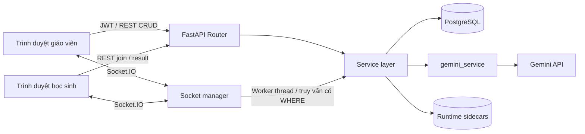
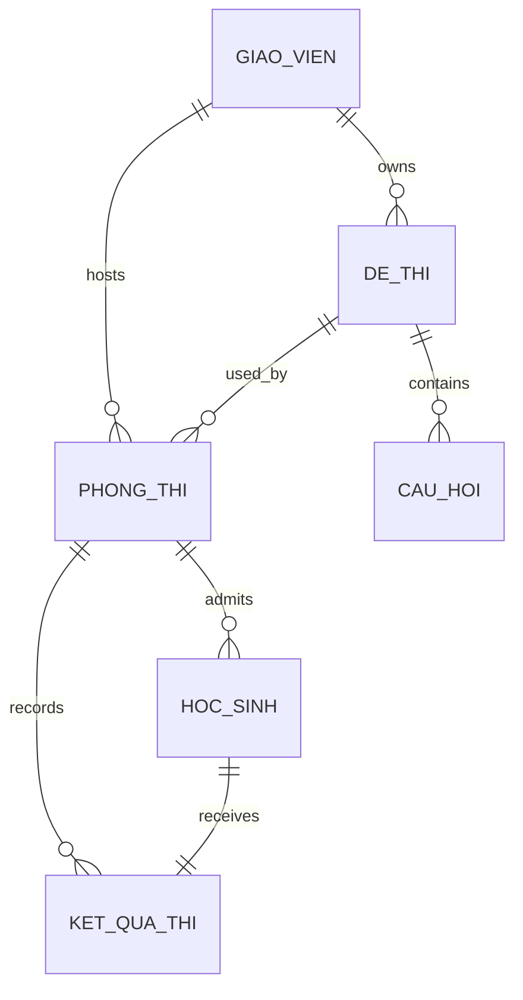

# Báo cáo đồ án — Quiz AI & Exam System

## Thông tin trình bày

- Học phần: Lập trình Web.
- Đề tài: Sinh đề trắc nghiệm bằng Gemini và tổ chức thi trực tuyến.
- Sinh viên, mã số, lớp, giảng viên: bổ sung khi nộp báo cáo.
- Phạm vi: Task 1.1–5.3 trong [master_plan.md](../master_plan.md).

## Bài toán và chức năng

Giáo viên thường phải chuyển tài liệu thành câu hỏi, quản lý danh sách đề và tổng hợp kết quả thủ công. Hệ thống hỗ trợ sinh câu hỏi từ văn bản, kiểm duyệt trước khi lưu, tạo phòng thi bằng mã ngắn và theo dõi kết quả trực tiếp. Học sinh tham gia bằng họ tên và mã phòng trên giao diện đáp ứng cho điện thoại.

Các chức năng đã triển khai: xác thực giáo viên JWT/bcrypt; sinh đề JSON có kiểm tra; CRUD kho đề với quyền sở hữu; tạo phòng/mã UNIQUE; tham gia ẩn danh; bắt đầu thi/đồng hồ đồng bộ; mất kết nối/khôi phục; nộp và chấm tự động thang 10; kết quả học sinh; bảng xếp hạng giáo viên, đóng phòng và xuất CSV.

## Kiến trúc

Frontend dùng React component/hook, React Router và TailwindCSS. Backend tách Router → Service → ORM; Pydantic v2 kiểm tra hợp đồng. Mã AI chỉ trong `gemini_service.py`. Tác vụ DB đồng bộ của Socket chạy ngoài event loop. Membership/lock theo room code; điểm và trạng thái cá nhân chỉ broadcast đến nhóm giáo viên sở hữu phòng.

Runtime sidecars lưu dữ liệu thời gian/receipt/chi tiết điểm vì sơ đồ lớp cố định không có những cột này. PostgreSQL là nguồn chính cho quan hệ, trạng thái và điểm. Một worker được dùng để giữ thứ tự sự kiện và lock trong process.

## Thiết kế dữ liệu

Sáu entity giữ nguyên theo `backend/app/models/models.py`; không thêm bảng/cột trong QA.

Cascade composition giữ `all, delete-orphan`: đề → câu hỏi; phòng → học sinh/kết quả. Bảng `HocSinh` tham chiếu phòng bằng mã code. Code có UNIQUE tại database và cơ chế retry khi collision. Điểm kiểu float, thời gian làm bài kiểu int phút, ngày tạo kiểu Date. API sử dụng ID chuỗi theo ORM hiện hữu.

## Luồng thi và độ an toàn

Phòng chuyển `DANG_CHO → DANG_THI → DA_DONG`. Khi bắt đầu, backend lưu deadline, cập nhật trạng thái bằng transaction, sau đó broadcast câu hỏi qua whitelist không chứa đáp án đúng. Client tính countdown từ deadline và clock server đã đồng bộ.

Bài làm bắt đầu `DANG_THI`; mất socket cuối chuyển `MAT_KET_NOI`, lưu mốc đóng băng và thông báo giáo viên. Khôi phục cùng phiên trước deadline chuyển lại `DANG_THI`, giữ đáp án tại trình duyệt và không cộng thời gian. Nộp bài cập nhật điểm và `HOAN_THANH` trong một transaction; retry không thay đáp án đã được nhận.

Điểm tính `round((so_cau_dung / tong_so_cau) * 10, 2)`. Câu bỏ trống được tính sai. Lấy đáp án đúng từ DB theo đề của phòng; client không quyết định điểm hoặc số câu. Broadcast `student_submitted` chỉ sau commit, lỗi thông báo không hủy điểm đã lưu.

ERR_01 hủy tác vụ AI sau 15 giây hoặc khi JSON không hợp lệ, rollback và trả 503/400; không lưu đề rỗng. ERR_02 ghi `MAT_KET_NOI` và cho phép khôi phục theo deadline. ERR_03 chặn dữ liệu sai bằng Pydantic và trả 422. Transaction tạo đề+câu hỏi và tham gia học sinh+kết quả đều có rollback.

## Kiểm thử và kết quả

[QA_REPORT.md](QA_REPORT.md) cung cấp bảng nghiệm thu 8 bước, số lượng test, phạm vi mobile và bằng chứng JSON/ảnh. E2E tích hợp sử dụng Chrome, Gemini thật và schema PostgreSQL riêng, được dọn sau kiểm thử. Test tự động thông thường dùng fixtures/mocks để kiểm tra timeout, lỗi DB, quyền sở hữu, duplicate submission, race và payload bảo mật.

[API_DOCUMENTATION.md](API_DOCUMENTATION.md) mô tả REST/Socket, schema, state và lỗi; [README.md](../README.md) hướng dẫn setup và chạy bằng hai lệnh.

## Kịch bản demo khoảng 5 phút

1. Giới thiệu mục tiêu và sơ đồ kiến trúc.
2. Đăng nhập giáo viên, upload `.txt`, sinh 3 câu hỏi, kiểm duyệt và lưu.
3. Tạo phòng, chia sẻ code; học sinh vào bằng một trình duyệt độc lập.
4. Bắt đầu thi, quan sát câu hỏi và countdown; ngắt kết nối rồi F5 cùng phiên để chứng minh khôi phục.
5. Nộp bài, xem điểm học sinh/bảng xếp hạng giáo viên, xuất CSV và đóng phòng.

Chuẩn bị PostgreSQL và API key có quota; dùng text ngắn. Nếu API ngoài không khả dụng, trình bày log/ảnh nghiệm thu được lưu trong `docs/qa/` và nói rõ đó là bằng chứng của lần chạy trước.

## Giới hạn và hướng phát triển

Chưa có Redis/multi-worker, admission token riêng, chống gian lận, xác thực danh tính học sinh, phân tích PDF/DOCX hoặc resume trên thiết bị khác. Học sinh cần giữ phiên tab; tab mới không có sessionStorage. Kiểm thử responsive hiện là Chrome mô phỏng, chưa trên điện thoại vật lý. Điểm chi tiết và deadline phụ thuộc runtime sidecars. Bài nộp muộn hiện được chấp nhận có đánh dấu; cần chính sách riêng nếu triển khai thi chính thức.

Hướng phát triển sau đồ án: chia sẻ realtime bằng Redis, tăng bảo vệ định danh ẩn danh, thiết kế lưu deadline/receipt bền vững bằng migration được phê duyệt, kiểm thử tải và thiết bị thực. Những phần này chưa được triển khai trong Task 5.3.
